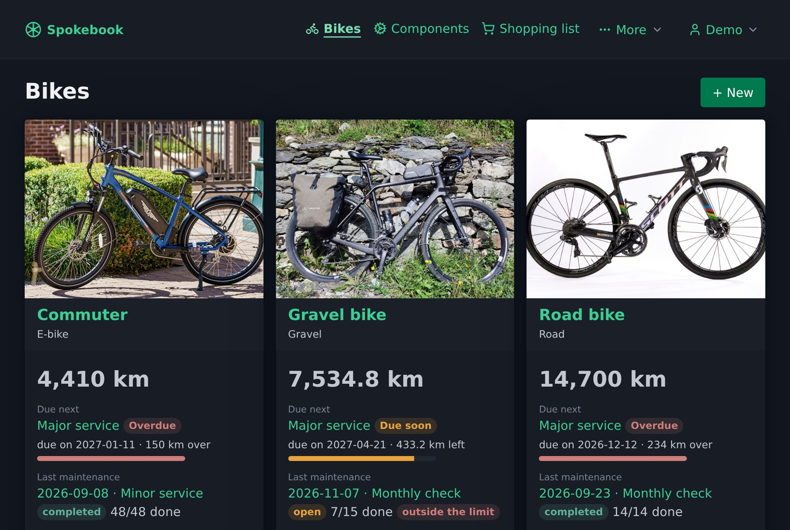

# Spokebook

A self-hosted web app for documenting the maintenance of your bikes: components with purchase data and
mileage, a catalog of maintenance steps ordered by phase and assembly group, torques and wear limits,
and a history of the maintenance you have done.

**Website: [spokebook.org](https://spokebook.org)** with features, installation guide, documentation
and news, in English and German.

> **Status: early development.** Expect missing features and breaking changes; back up the database.

> **Spokebook only makes suggestions.** You are responsible for the maintenance of your bike; the
> manufacturer's instructions always take precedence. See the [disclaimer](#disclaimer).



## Why

Existing apps mostly count kilometers from Strava and send reminders. Spokebook puts the maintenance
itself first: you pick a level for a bike (pre-ride check, monthly check, minor or major service), work
through its steps from the catalog and record measurements along the way, such as chain stretch or
brake pad thickness. Features of a bike such as a carbon frame, tubeless tires, an e-bike drive,
suspension, hydraulic brakes, a hub gear, a belt drive or electronic shifting add, replace or drop
steps and add hints. Values beyond their limit are flagged. The steps are copied when you start, so the
history stays correct even if you change the catalog later.

## Roadmap

- **v0.1**: login with passkeys, bikes, mileage readings, components and their installations,
  a step catalog with phases, assembly groups and levels including a built-in starter catalog,
  performing and checking off a maintenance
- **v0.2**: due dates by mileage and time, attachments (invoices, photos), installable as a PWA,
  mileage import from GPX/FIT/TCX files and Garmin Connect
- **v0.3**: more modules switched on by bike features (hydraulic brakes, hub gear, belt drive,
  electronic shifting) and smaller improvements
- **Later**: own modules in the UI, OIDC, CSV export, inviting more users, a public API

The current state is on the [roadmap page](https://spokebook.org/en/roadmap/) of the website, details
are in the [concept](docs/konzept.md) (German).

## Technology

Go with `net/http` from the standard library, server-rendered HTML with
[htmx](https://htmx.org) (0BSD) and [Pico CSS](https://picocss.com) (MIT), both shipped in
`web/static/vendor`, SQLite. The app is a
single binary with embedded templates and migrations and needs no CGO.

## Running with Docker

Every release is published as a container image for `linux/amd64` on the GitHub Container Registry:
`ghcr.io/spokebook/spokebook` with the tags `<version>` (e.g. `0.3.0`), `<major>.<minor>` and `latest`.
The image listens on port 8080 and keeps its database in `/data`; it runs as user 65532 by default.
See also the [installation guide](https://spokebook.org/en/install/) on the website.

```yaml
services:
  spokebook:
    image: ghcr.io/spokebook/spokebook:latest
    restart: unless-stopped
    user: "568:568"            # optional, e.g. the TrueNAS "apps" user; must own ./data
    ports:
      - "8080:8080"
    environment:
      APP_BASE_URL: https://bikes.example.com
      APP_TRUSTED_PROXIES: 192.168.1.10   # address of the reverse proxy as the container sees it
      # APP_SECRET_KEY: ...    # needed for Garmin Connect; create one with: openssl rand -base64 32
    volumes:
      - ./data:/data
```

`APP_BASE_URL` must be the exact address users open, since passkeys and `Secure` cookies depend on it.
Behind a reverse proxy that terminates TLS, set it to the `https://` address and let the proxy pass
the original `Host` header through (Traefik does by default); requests whose `Origin` does not match
the host are rejected as cross-site. The setup link for the first account appears in the container
log.

To build the image yourself: `docker build -t spokebook .`

### Configuration

All settings are environment variables. The defaults suit development; in the image, `APP_ADDR` is
`:8080` and `APP_DB_PATH` is `/data/spokebook.sqlite`.

| Variable | Default | Meaning |
| --- | --- | --- |
| `APP_ADDR` | `localhost:8080` | Address the server listens on |
| `APP_DB_PATH` | `data/dev.sqlite` | Path to the SQLite database; created and migrated at startup |
| `APP_BASE_URL` | `http://localhost:8080` | Address users open. Passkeys are bound to its host; with `https://`, cookies are `Secure` and HSTS is sent |
| `APP_TRUSTED_PROXIES` | (none) | Comma-separated IP addresses or CIDR ranges of reverse proxies whose `X-Forwarded-For` header is believed, e.g. `192.168.1.10` or `172.16.0.0/12` |
| `APP_LOG_LEVEL` | `info` | `debug`, `info`, `warn` or `error`; `debug` logs every request with method, path, status, duration and client address |
| `APP_SECRET_KEY` | (none) | At least 32 characters, e.g. from `openssl rand -base64 32`. Encrypts the credentials of ride sources such as the Garmin API key; without it, Garmin Connect can't be connected. If it changes, the stored keys must be entered again |

### First login

As long as there is no account, the server writes a setup link with a one-time token to its log at
every start (`no account yet, open this link to create one`). Open it and create the account with a
name and password; afterwards you can add passkeys on the account page. Data entered before login
existed belongs to this first account.

Login is limited to 10 attempts per client and minute. After 5 wrong passwords in a row, the account
is locked for 15 minutes. Behind a reverse proxy, set `APP_TRUSTED_PROXIES` to the
proxy's address so the limit applies per client; otherwise all clients share the proxy's address and
the limit applies to all of them together.

### Backup

Under *Account → Backup*, **Export** downloads all your data (bikes, odometer readings, components,
component types, catalog, intervals, maintenances, rides and their bike mappings, photos and documents,
shopping list) as a ZIP file with a versioned JSON file and the attachments. **Import** restores such a
file: it replaces all of your data in one transaction, so a damaged file changes nothing. Accounts,
passwords, passkeys and ride source credentials (Garmin API key) are not part of the backup and stay as
they are. A backup from an older version of Spokebook can be imported into a newer one, including the
plain JSON files of the first backup format.

To back up the whole server including accounts, copy the database in `/data` while the container is
stopped.

### Garmin Connect

Under *Rides → Garmin Connect*, paste a personal API key created in Garmin Connect (*Settings →
Personal API Key*) and choose the first day to fetch. Spokebook then fetches your cycling activities
once a day (or with *Fetch now*), downloads the original FIT file of each new one and imports it like
an uploaded file; the Garmin gear chosen for a ride decides the bike. To be gentle with Garmin's rate
limit, requests are at least 2 seconds apart and a run downloads at most 100 activities; a longer
history continues hourly until it is complete, then fetching is daily again. The key is stored encrypted with `APP_SECRET_KEY` and is not part of the
backup. Garmin keys expire after 30 days to one year; the page tells you when a new one is needed.

## Development

The easiest way is the included dev container (`.devcontainer/`), which has Go, sqlc, goose, air and
golangci-lint installed.

```sh
air                      # run the app with live reload
go run ./cmd/spokebook   # or without live reload
go test ./...
```

Then open `http://localhost:8080`. Use `localhost`, not `127.0.0.1`, or passkeys won't work. Outside
Docker, the defaults in the table above apply.

## Contributing

Issues and pull requests are welcome; see also [Contribute](https://spokebook.org/en/contribute/) on
the website. After changing queries or migrations, run `sqlc generate` and commit the generated
files. Conventions and the directory layout are described in [CLAUDE.md](CLAUDE.md).

Commit messages follow [Conventional Commits](https://www.conventionalcommits.org): `fix:` leads to
a patch release, `feat:` to a minor release, and a `BREAKING CHANGE:` footer to a major release.
Releases are made by [semantic-release](https://semantic-release.gitbook.io) on every push to `main`,
which also builds and pushes the image.
Dependabot proposes updates of the Go modules, base images and actions once a week.

Please report security problems privately, see [SECURITY.md](SECURITY.md).

## Disclaimer

You maintain and repair your bike at your own responsibility. A badly maintained bike – with bolts
tightened wrongly, worn brake pads or a damaged carbon part, for example – can cause serious
accidents.

The maintenance steps, their order, levels, intervals, hints, follow-up steps and guidance values in
the built-in catalog and in the documentation are non-binding suggestions. They are general, not
complete, and may be wrong for your bike and your components. A maintenance that Spokebook shows as
finished, or a measurement it shows as within its limit, does not confirm that your bike is safe to
ride. Spokebook only works with the values you enter.

The instructions and figures of the manufacturers – torques, wear limits, service intervals, assembly
compounds – always apply. If you are unsure about a job or lack the tools or the experience, have it
done by a professional bike shop, in particular for brakes, steering, wheels, frame and fork, and
e-bike batteries.

Spokebook is provided without warranty, to the extent permitted by law; see sections 15 and 16 of
the [license](LICENSE).

## License

Copyright (C) 2026 Michael Neuendorf

Spokebook is licensed under the GNU Affero General Public License v3.0, see [LICENSE](LICENSE). If
you run a modified version as a network service, you must make its source code available to its
users. The link in the footer of every page points to `SourceURL` in
`internal/app/spokebook/version.go`; set it to your copy.
